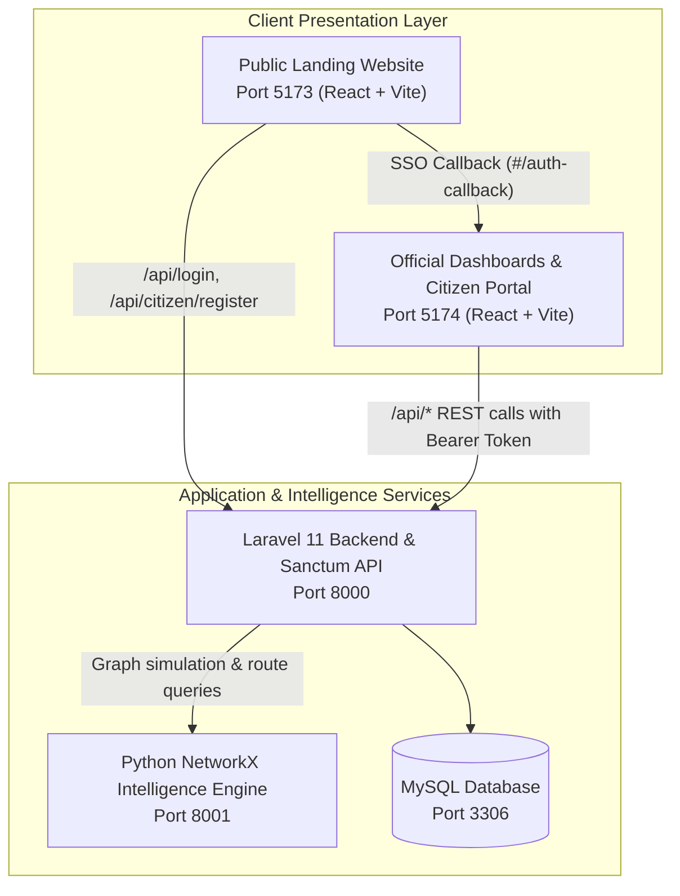

# GaunPulse — Integrated System Guide
**The Village That Speaks · एकीकृत ग्रामीण पूर्वाधार सूचना प्रणाली**

This document describes the unified architecture combining the **Public Landing Website** (from branch `GaunPulse-sandesh`) with the **Official Municipal Dashboards & Citizen Portal** (from branch `main`) under a single role-based authentication and routing system.

---

## 1. System Architecture Overview

The GaunPulse platform operates across 4 coordinated components:



### Component Summary

| Component | Directory | Dev Port | Description |
| :--- | :--- | :--- | :--- |
| **Public Website** | `public-website/` | `http://localhost:5173` | Modern, visual landing website featuring project mission, interactive public map, issue viewer, network simulator demo, research insights, official notices, citizen registration, and unified login. |
| **Official Dashboards & Citizen Portal** | `gaunpulse_start/frontend/` | `http://localhost:5174` | Role-guarded workspaces: Official Municipal Dashboard (System Admin, Municipality Admin, Ward Officer) and Citizen Portal (Incident reporting wizard, audio recorder & transcriber, my reports). |
| **Laravel Backend** | `gaunpulse_start/backend/` | `http://localhost:8000` | Unified REST API powered by Laravel 11 and Laravel Sanctum. Manages users, auth, municipalities, wards, villages, infrastructure nodes/edges, issues, and audit logs. |
| **Intelligence Microservice** | `gaunpulse_start/intelligence/` | `http://localhost:8001` | FastAPI + NetworkX microservice for topological graph connectivity analysis, critical bridge/road failure isolation simulation, and shortest hospital pathing. |

---

## 2. Unified Authentication & Role-Based Access Control

### Single Sign-On (SSO) & Login Entry Point
- All users sign in through the primary login page at `http://localhost:5173/login`.
- Authentication queries `POST /api/login` on the Laravel backend.
- The server validates credentials, verifies account activation (`is_active`), and returns:
  - Sanctum API bearer `token`
  - User model with server-verified `role`
  - Explicit `redirect_route` (`dashboard` or `citizen`)

### Server-Derived Redirection Matrix
The redirection destination is **strictly computed by the server** based on the database record:

| Role (`users.role`) | Target Workspace | Landing Route | Authorized Capabilities |
| :--- | :--- | :--- | :--- |
| `system_admin` | Main Admin Panel | `#/dashboard` | Global municipal workspace switching, user management, audit logs, village GIS manager, AI agents. |
| `municipality_admin` | Municipal Admin Panel | `#/dashboard` | Municipality-scoped infrastructure, issue verification, action planning, simulation runner, reports. |
| `ward_officer` | Ward Official Workspace | `#/dashboard` (Ward-scoped) | Ward-level issue review, local infrastructure monitoring, citizen report verification. |
| `citizen` | Citizen Portal | `#/citizen` | 4-step incident reporting wizard, audio recording & transcription, tracking submitted complaints, official notices. |

### Cross-Port SSO Token Handoff
When an authenticated user is redirected from the Public Website to the Dashboards:
1. `LoginPage.jsx` redirects to `${DASHBOARD_URL}/#/auth-callback?token=${token}&target=${target}`.
2. `AuthContext.jsx` immediately extracts the token during initialization and synchronizes:
   - `localStorage.setItem('gaunpulse_auth_token', token)`
   - `localStorage.setItem('gaunpulse_citizen_token', token)`
3. It immediately invokes `window.history.replaceState(null, '', '#/' + target)`. **No authentication token remains in the browser address bar or browsing history.**

### Route Guards & Privilege Separation
- **Frontend Route Protection (`App.jsx`):**
  - If a user with `role: 'citizen'` changes the URL hash to `#/dashboard`, `#/village-map`, or any administrative route, the guard immediately intercepts and redirects back to `#/citizen`.
  - If a user without admin privileges (e.g., `ward_officer` or guest) visits `#/user-management` or `#/audit-logs`, they are redirected to `#/dashboard`.
- **Backend Authorization (`EnsureAdmin.php` & Controller policies):**
  - Administrative endpoints (`/api/admin/users`, `/api/admin/audit-logs`, `/api/admin/dashboard`) reject citizen accounts with HTTP `403 Forbidden`.
  - Issue state transitions (`PATCH /api/issues/{id}/status`) require municipal staff (`isStaff()`), preventing unauthorized status manipulation.
  - Citizen portal login (`/api/citizen/login`) is restricted exclusively to citizen accounts.
  - Citizen registration (`/api/citizen/register`) enforces `role: 'citizen'`; users cannot elevate their own permissions.

---

## 3. Running the Entire Application Locally

Run the following commands in separate terminal sessions:

### Terminal 1: Laravel Backend
```powershell
cd gaunpulse_start\backend
php artisan serve --host=127.0.0.1 --port=8000
```
*Health check:* `http://127.0.0.1:8000/api/municipalities`

### Terminal 2: Python Intelligence Service
```powershell
cd gaunpulse_start\intelligence
python -m uvicorn main:app --host 127.0.0.1 --port 8001
```
*Health check:* `http://127.0.0.1:8001/`

### Terminal 3: Dashboards & Citizen Portal
```powershell
cd gaunpulse_start\frontend
npm run dev
```
*Dashboard URL:* `http://localhost:5174`

### Terminal 4: Public Landing Website
```powershell
cd public-website
npm run dev
```
*Public Website URL:* `http://localhost:5173`

---

## 4. Default Seeded Credentials

| Account Role | Email | Password | Intended Portal |
| :--- | :--- | :--- | :--- |
| **System Administrator** | `admin@gaunpulse.gov.np` | `admin123` | Official Dashboard (`#/dashboard`) |
| **Municipality Admin** | `helambu.admin@gaunpulse.gov.np` | `password` | Official Dashboard (`#/dashboard`) |
| **Ward Officer (Ward 1)** | `ward1.officer@gaunpulse.gov.np` | `password` | Official Dashboard (`#/dashboard`) |
| **Verified Citizen** | `ram.shrestha@example.com` | `password` | Citizen Portal (`#/citizen`) |

---

## 5. Automated Verification Test Suite

To verify all backend authentication endpoints, route guards, and role redirects:

```powershell
cd gaunpulse_start\backend
php artisan test --filter=UnifiedRoleBasedAuthTest
php artisan test --filter=SecurityAndWorkspaceTest
```

To run build verification on both frontend projects:
```powershell
# Public landing website
cd public-website
npm run build

# Official dashboards & citizen portal
cd gaunpulse_start\frontend
npm run build
```
