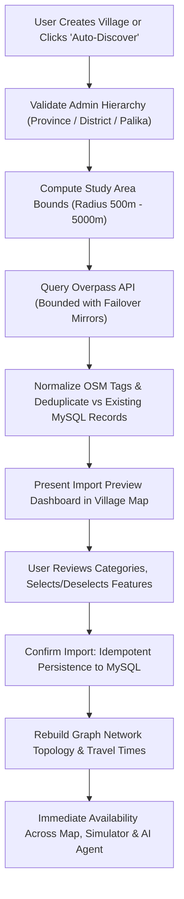

# Automatic Nepal Village Infrastructure Discovery & Import

## Overview

GaunPulse features an automated geographic discovery and ingestion pipeline that enables municipal planners, disaster response teams, and local engineers to onboard any village in Nepal and instantly discover its critical lifelines (roads, footpaths, bridges, schools, health posts, water points, and settlements) from OpenStreetMap (OSM) without manual node-by-node data entry.

---

## 1. Complete Discovery & Import Pipeline

### Steps in Detail

1. **Triggering Discovery**:
   - **Automatic trigger**: Upon submitting "+ Add New Village" in the Village Map modal, the newly created village is automatically targeted, and discovery is launched immediately.
   - **On-demand trigger**: Planners can click the **"Auto-Discover Infrastructure"** button on the village toolbar at any time to refresh or expand the study area.
2. **Administrative Hierarchy Validation**:
   - Every village is strictly validated against Nepal's 7 provinces, 77 districts, and corresponding Palikas (rural municipalities/municipalities).
   - Cross-district mismatches (such as Marpha in Mustang placed under Helambu in Sindhupalchok) are blocked at creation with clear suggestions (`/api/villages/audit-hierarchy` and `/api/villages/{id}/correct-hierarchy`).
3. **Study Area Selection**:
   - Planners choose a study radius (e.g. 1000m, 2000m, 3000m, 5000m).
   - A reactive Leaflet `<Circle>` boundary visually highlights the coverage area directly on the map.
4. **Resilient Overpass Querying**:
   - Queries `overpass-api.de`, `overpass.kumi.systems`, and `maps.mail.ru` with automated failover and 24-hour cache keys.
   - In test/isolated environments, deterministic Nepal fixtures ensure continuous integration stability.
5. **Interactive Preview Dashboard**:
   - Displays clear stat cards for Roads & Trails, Bridges, Schools, Health Posts, Water Points, and Settlements.
   - Highlights duplicate warnings against existing local database nodes.
   - Provides individual category tabs and checkboxes to include/exclude features.
6. **Idempotent Persistence & Verified Protection**:
   - Persists selected nodes, edges, and facilities using unique OSM IDs and coordinate proximity checks.
   - Never overwrites locally verified or community-endorsed records (`verification_status = 'verified'`).
7. **Graph Pipeline & Application Synchronization**:
   - Connects facility nodes to road junctions, calculates travel times based on slope/surface, and updates simulation lifelines.

---

## 2. API Endpoints

| Endpoint | Method | Description |
|---|---|---|
| `/api/villages/audit-hierarchy` | `GET` | Scans all database villages for province/district/palika mismatches |
| `/api/villages/{id}/correct-hierarchy` | `POST` | Corrects misassigned administrative hierarchy with audit logging |
| `/api/villages/{id}/discover-osm` | `POST` | Fetches OSM candidate features for preview within bounding radius |
| `/api/villages/{id}/confirm-osm-import` | `POST` | Persists user-approved features into MySQL nodes, edges, and facilities |
| `/api/villages/{id}/import-history` | `GET` | Returns audit trail of OSM import batches for the village |

---

## 3. Honest Data Representation

GaunPulse adheres strictly to the **Honest Data Principle**:
- When zero schools or health posts are found in OpenStreetMap, GaunPulse displays:
  > *"No mapped records found in the selected data source. Local verification is needed."*
- GaunPulse **never** states *"This village has no schools"* or *"This village has no healthcare"*, acknowledging open-source mapping coverage gaps in remote mountain topography.
- Population and household statistics are **never invented** from raw OSM data. Official census or ward survey values remain preserved.
