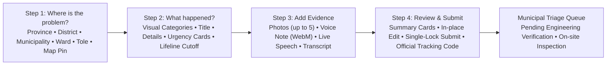

# GAUNPULSE — CITIZEN PORTAL UX REDESIGN & GUIDED 4-STEP REPORTING WORKFLOW

**Document Reference:** `docs/CITIZEN_PORTAL_UX_REDESIGN.md`  
**Platform:** GaunPulse — The Village That Speaks  
**Audience:** Municipal Engineers, Ward Officers, Product Managers, Citizens  
**Aesthetic & Design Standard:** Forest-Green Identity (`#123D30`, `#267153`), Warm Cream Backgrounds, High-Contrast Accessible Elements, Minimalist SaaS Polish.

---

## 1. Executive Summary & Problem Analysis

In rural Nepal, citizens encounter critical infrastructure breakdowns—landslides blocking school trails, washed-out wooden bridges, snapped drinking water pipes, and river erosions. Previously, rural complaints faced severe UX barriers:
1. **Unrealistic administrative constraints:** Hardcoded municipality dropdowns (such as Helambu only) preventing citizens in Karnali, Sudurpashchim, or Gandaki from lodging complaints.
2. **Missing settlements error:** When a ward had no cataloged villages in MySQL, the form displayed *"No registered village in Ward X"* and blocked submission.
3. **Overwhelming single-page scroll form:** Too many technical GIS and categorical questions at once overwhelmed mobile users on low-bandwidth rural connections.
4. **Language gap:** Absence of intuitive Nepali Devanagari navigation and status explanations.

To resolve these barriers, the GaunPulse Citizen Portal was re-architected into a **guided 4-step progressive disclosure wizard** designed with mobile-first touch ergonomics (minimum 44px touch targets), persistent form draft preservation, comprehensive bilingual localization (`नेपाली` | `English`), and seamless integration with the Municipal Operations Center.

---

## 2. Guided 4-Step Incident Reporting Architecture

### Step 1: Where is the Problem? (घटनास्थल)
* **Instant Municipality Quick Search:** Search bar supporting English and Nepali names (e.g. *Helambu, Dailekh, Pokhara, महाबु*) returning instant municipality pills with district, province, and ward counts.
* **Cascading 5-Tier Administrative Selectors:**
  1. *Province:* All 7 Provinces (Koshi to Sudurpashchim).
  2. *District:* Filtered by selected province (all 77 districts).
  3. *Municipality:* Filtered by selected district.
  4. *Ward Number:* Dynamic range based on the municipality's official ward count.
  5. *Village / Settlement:* Pre-registered villages populated dynamically.
* **Unregistered Settlement Safeguard:** If no pre-registered village is present or the citizen chooses `+ Other / Unregistered Settlement`, an input for `Settlement / Tole Name *` is displayed with a reassuring notification:
  > *"Ward has no pre-registered village cataloged. Your entered settlement will be submitted for municipal verification without creating a duplicate record."*
* **Interactive Leaflet GIS Pin:** Custom SVG pin marker (eliminating 404 missing asset errors), draggable marker, coordinates display, clear pin button, and an explicit GPS button (*"Use My Current Location"*).

### Step 2: What Happened? (घटना विवरण)
* **Visual Problem Category Grid:** 12 touch cards with icons (Road Damage, Bridge Damage, Drinking Water Supply, Water Pipeline, Drainage, Street Light, School Access, Health Facility Access, Landslide, Flood Damage, Public Building, Other).
* **Clear Report Title:** Required string (min 5 characters) with clear contextual placeholders.
* **Detailed Description & Community Impact:** Multi-line textarea detailing impact on local commute, schools, and medical clinics.
* **Citizen Urgency Indicators (Citizen-Estimated):**
  - **Critical Hazard (गम्भीर जोखिम):** Complete trail/bridge cutoff or active landslide.
  - **High (उच्च):** Primary transport or drinking water disrupted.
  - **Medium (मध्यम):** Partial damage, passable with difficulty.
  - **Low (सामान्य):** Minor repair or routine maintenance needed.
  *Includes explicit disclaimer:* `Subject to official verification by municipal technical staff.`
* **Vital Lifeline Cutoff Toggle:** Highlights urgent vulnerabilities where children or patients are cut off from basic services.

### Step 3: Add Evidence (प्रमाण तथा आवाज)
* **Photographic Evidence (`ImageUploader`):** Up to 5 photos with immediate client-side preview thumbnails, 5MB file-size limit enforcement, and per-photo removal controls.
* **Voice Reporting & Speech-to-Text (`VoiceRecorder`):**
  - Spoken voice recording (Opus/WebM/MP3) with live timer (`00:08`).
  - Audio playback bar and dedicated `Download Audio (.webm)` button.
  - Server-side speech-to-text (`/api/citizen/transcribe`) with browser Web Speech API fallback.
  - Editable transcript textarea with `Download Transcript (.txt)` button (UTF-8 BOM `\uFEFF` encoded for Devanagari support in Windows/Notepad).
  - `Copy to Description` shortcut button.

### Step 4: Review & Submit (समीक्षा र पेश गर्नुहोस्)
* **Structured Review Cards:**
  - *Location Summary:* Shows Province, District, Municipality, Ward, Settlement, Coordinates, with an `[Edit]` button jumping directly to Step 1.
  - *Incident Summary:* Shows Category, Title, Description, Urgency, Affected households, and Lifeline status, with an `[Edit]` button jumping directly to Step 2.
  - *Evidence Summary:* Shows photo count, voice recording presence, and transcript preview, with an `[Edit]` button jumping directly to Step 3.
* **Draft Preservation:** Navigating backward and forward never clears user input or unmounts uploaded blobs.
* **Single-Click Lock:** Submission button disables immediately and shows a spinner (`Submitting report...`) to prevent duplicate records.
* **Confirmation Screen:**
  - Displays generated tracking code (e.g. `GP-HLB-2026-0042`).
  - Illustrates the 3-phase Municipal Verification Timeline:
    1. *Submitted:* Received by Municipal Operations.
    2. *Review Queue:* Assigned to Ward Engineers for on-site verification.
    3. *Repair Planning:* Verified incidents promoted into Priority & Action Plans.
  - Direct action buttons: *Track This Report* and *File Another Report*.

---

## 3. Accessibility & Mobile-First Standards

| Feature | Standard Implemented | Impact on Citizens |
| :--- | :--- | :--- |
| **Touch Targets** | `min-height: 44px; min-width: 44px;` | Eliminates mis-taps on small mobile screens on bumpy rural roads. |
| **Color Contrast** | Forest Green `#123D30` on `#FFFFFF` (Ratio > 11:1) | Complies with WCAG 2.1 AAA for outdoor daylight readability. |
| **Devanagari Font Rendering** | Native system font stacks with UTF-8 BOM encoding | Clear rendering of Nepali conjuncts across Android, iOS, and Windows. |
| **Offline / Low-Bandwidth Guard** | Preserves state in React memory across all wizard steps | Citizens do not lose typed descriptions if a step change occurs on weak 3G. |

---

## 4. Summary of Verification & Outcomes

The redesign guarantees that every citizen in Nepal—regardless of their literacy level, language preference, or location—can file an actionable infrastructure report in under 90 seconds.
