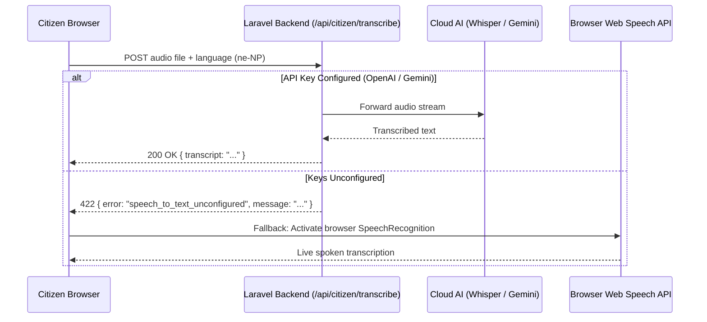

# GAUNPULSE — CITIZEN VOICE REPORTING & DUAL SPEECH-TO-TEXT ARCHITECTURE

**Document Reference:** `docs/CITIZEN_VOICE_REPORTING.md`  
**Platform:** GaunPulse — The Village That Speaks  
**Component:** `VoiceRecorder.jsx` & `/api/citizen/transcribe`  
**Supported Languages:** Nepali (`ne-NP`) and English (`en-US`)

---

## 1. Problem Statement & Rural Context

In rural Nepal, many residents facing dangerous infrastructure hazards are non-typists or use mobile devices that lack comfortable Devanagari keyboards. Audio recording is vital for accessibility, but municipal engineers cannot listen to hundreds of voice notes sequentially. 

Citizens must be able to:
1. Speak naturally in **Nepali** or **English**.
2. Have their voice converted into **written text**.
3. Inspect and edit the transcription.
4. Listen back to the recording.
5. Download both the audio file and transcript for their personal records.

---

## 2. The 8-Step Voice Reporting Workflow

```
[1. Select Voice Language: Nepali / English]
                     ↓
[2. Click 'Start Recording Voice' (Microphone Permission Check)]
                     ↓
[3. Speak Hazard Details (Live Timer 00:08 / Pulsing Waveform)]
                     ↓
[4. Click 'Stop Recording' (MediaRecorder produces audio/webm)]
                     ↓
[5. In-Browser Audio Player (Playback & Quality Verification)]
                     ↓
[6. Click 'Transcribe Audio' (Backend Whisper/Gemini with Fallback)]
                     ↓
[7. Edit & Correct Transcript in Textarea (Devanagari / English)]
                     ↓
[8. Download Options: 'Download Audio' (.webm) & 'Download Transcript' (.txt with UTF-8 BOM)]
```

---

## 3. Dual-Engine Architecture: Server + Client Fallback

GaunPulse implements a resilient, multi-tiered transcription strategy that never fails silently or fakes transcriptions:



### 1. Server-Side Transcription (OpenAI Whisper & Gemini 1.5/2.0 Flash)
- **Endpoint:** `POST /api/citizen/transcribe`
- **Payload:** Multipart form containing `audio` file (`webm`, `mp3`, `wav`, `m4a`, `ogg`, max 10MB) and `language` (`ne-NP` or `en-US`).
- **Processing:**
  - If `OPENAI_API_KEY` is present, dispatches to `https://api.openai.com/v1/audio/transcriptions` with model `whisper-1` and language `ne` or `en`.
  - If `GEMINI_API_KEY` is present, submits audio inline to Gemini multimodal speech endpoint.
- **Honest Error Handling:** If neither key is configured, the endpoint returns:
  ```json
  {
    "success": false,
    "error": "speech_to_text_unconfigured",
    "message": "AI transcription keys (GEMINI_API_KEY or OPENAI_API_KEY) are not configured in backend/.env. Using live in-browser speech recognition instead."
  }
  ```
  The system **never creates fake transcripts**.

### 2. Client-Side Fallback (Browser Web Speech API)
- When the server-side API reports unconfigured keys, `VoiceRecorder.jsx` automatically prompts the user and initiates `window.webkitSpeechRecognition` or `window.SpeechRecognition`.
- Continuous dictation with `recognition.lang = 'ne-NP'` or `'en-US'`.
- Real-time word streaming into the editable transcript area.

---

## 4. Devanagari UTF-8 BOM Safe Download

When citizens download transcripts containing Nepali Devanagari characters (e.g. `हाम्रो गाउँको पुल बिग्रिएको छ`), standard text files often open with corrupted character encoding (mojibake) in Windows Notepad.

GaunPulse prefixes the transcript payload with the **UTF-8 Byte Order Mark (`\uFEFF`)**:
```javascript
const blob = new Blob(['\uFEFF' + speechTranscript], {
  type: 'text/plain;charset=utf-8',
});
const url = URL.createObjectURL(blob);
const a = document.createElement('a');
a.href = url;
a.download = `gaunpulse-transcript-${Date.now()}.txt`;
a.click();
URL.revokeObjectURL(url);
```
This guarantees crisp, native Devanagari display across Windows, macOS, Linux, and Android.
