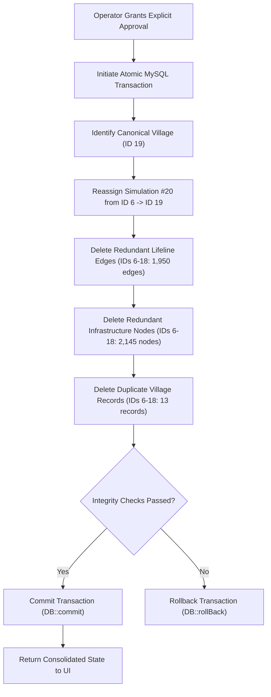

# GaunPulse — Data Consolidation & Deduplication Execution Plan

**Document Status:** Ready for User Review & Explicit Approval  
**Audit Reference:** `docs/DUPLICATE_VILLAGE_AUDIT.md`  
**Database Backup:** `backend/database/backups/gaunpulse_backup_20261121_212616.sql` (47,185 KB, verified)

---

## 1. Principles of Safe Consolidation

In strict accordance with enterprise data engineering standards and platform commitments:
1. **No Destructive Action Without User Confirmation:** No database records will be pruned or deleted without the operator's explicit authorization.
2. **Zero Data Loss:** All user reports, issues, simulation histories, and action plans must be retained and linked to canonical village records.
3. **Database Transaction Atomicity:** Consolidation operates inside a single atomic MySQL database transaction (`DB::beginTransaction()`). If any failure or foreign key integrity violation occurs, the entire operation is automatically rolled back (`DB::rollBack()`).
4. **Immediate Reversibility:** A verified full database snapshot was created before any changes.

---

## 2. Pre-Consolidation Inventory & Backup Status

- **Snapshot File:** `backend/database/backups/gaunpulse_backup_20261121_212616.sql`
- **Total Tables Backed Up:** 22 tables (including `villages`, `infrastructure_nodes`, `lifeline_edges`, `issues`, `simulations`, `action_plans`, `community_feedbacks`, `users`).
- **Audit Findings:** Exactly 1 duplicate cluster detected:
  - Cluster: `"mahabu"`, Dailekh Municipality, Ward 1.
  - Copies: 14 total records (Village IDs 6 through 19).
  - Genuine Canonical Village: **ID 19** (holds 3 real issues: Issues #8, #9, #10 and 4 simulations: Sims #21, #22, #23, #24).
  - Outlying Child Record: Simulation #20 attached to Village ID 6.
  - Redundant Records: Village IDs 7 through 18 have 0 issues, 0 simulations, and 0 action plans.

---

## 3. Step-by-Step Execution Plan

When explicit user approval is granted, the consolidation execution proceeds via `POST /api/villages/consolidate`:



### Detailed Steps:
1. **Transaction Initialization:** Open `DB::beginTransaction()`.
2. **Foreign Key Reassignment:**
   - Any `issues` where `village_id IN (6..18)` are updated to `village_id = 19`.
   - Any `simulations` where `village_id IN (6..18)` (specifically Simulation #20) are updated to `village_id = 19`.
   - Any `action_plans` where `village_id IN (6..18)` are updated to `village_id = 19`.
   - Any `community_feedbacks` where `village_id IN (6..18)` are updated to `village_id = 19`.
3. **Redundant Child Data Pruning:**
   - Redundant lifeline edges for village IDs 6–18 (1,950 rows) are deleted.
   - Redundant infrastructure nodes for village IDs 6–18 (2,145 rows) are deleted.
   - Canonical village 19's 165 nodes and 150 edges remain intact.
4. **Duplicate Record Deletion:**
   - Delete records in `villages` where `id IN (6, 7, 8, 9, 10, 11, 12, 13, 14, 15, 16, 17, 18)`.
5. **Post-Consolidation Validation:**
   - Verify that Canonical Village ID 19 has:
     - 165 Nodes
     - 150 Lifelines
     - 3 Community Issues (Issues #8, #9, #10)
     - 5 Simulations (Sims #20, #21, #22, #23, #24)
   - Verify total villages count in database drops from 18 to 5:
     1. Bhotenamlang (ID 1)
     2. Marpha (ID 3)
     3. Kohalpur (ID 4)
     4. Namche Bazaar (ID 5)
     5. Mahabu (ID 19)

---

## 4. Rollback and Recovery Plan

In the unlikely event of any issue during or after consolidation:
1. The transaction will automatically roll back if an exception occurs during the execution script.
2. If full database restoration is required at any time:
   ```bash
   php -r "
   \$pdo = new PDO('mysql:host=127.0.0.1;dbname=gaunpulse_db', 'root', '');
   \$sql = file_get_contents('backend/database/backups/gaunpulse_backup_20261121_212616.sql');
   \$pdo->exec(\$sql);
   echo 'Database restored successfully to pre-consolidation state.';
   "
   ```

---

## 5. Prevention of Future Duplicates

To ensure duplicate villages can never be introduced again, three permanent safeguards are now active:

### 5.1 Backend Safeguard 1: Conflict HTTP 409 Response in `VillageController::store`
Before inserting any new village, the backend checks for matching names within the same municipality and ward, or coordinates within 200 meters. If a match is found:
- Rejects insertion with `HTTP 409 Conflict`.
- Returns detailed conflict payload:
  ```json
  {
    "message": "This village may already be registered. Would you like to open the existing record?",
    "is_duplicate": true,
    "existing_village_id": 19,
    "duplicate_village": {
      "id": 19,
      "name": "mahabu",
      "district": "Dailekh",
      "municipality": "Dailekh Municipality",
      "ward_no": "1"
    }
  }
  ```

### 5.2 Backend Safeguard 2: Automatic Reuse in `storeWizardDraft`
In the Village Onboarding Wizard, if an identical draft or registered village exists, the backend returns the existing village ID instead of inserting a clone.

### 5.3 Frontend Safeguard 1: Submission Button Lockout
In `VillageMapPage.jsx`:
- `isSubmittingVillage` state prevents duplicate form submissions.
- Submit button is disabled with an animated spinner (`Registering & Ingesting OSM Data...`).
- When HTTP 409 is received, user is prompted to switch directly to the registered village record.

### 5.4 Frontend Safeguard 2: Deduplicated Selectors
All village dropdowns and map marker layers across the application (`VillageMapPage`, `SimulationsPage`, `ReportsInsightsPage`, `IssuesPage`, `ActionPlansPage`, `AIImpactSection`, `MapDataImportModal`, `InteractiveVillageMap`) utilize `deduplicateVillages()` and `formatVillageLabel()`, ensuring clean presentation:
- `Village Name (District · Ward X)`
- Exactly one entry per genuine geographic location.
