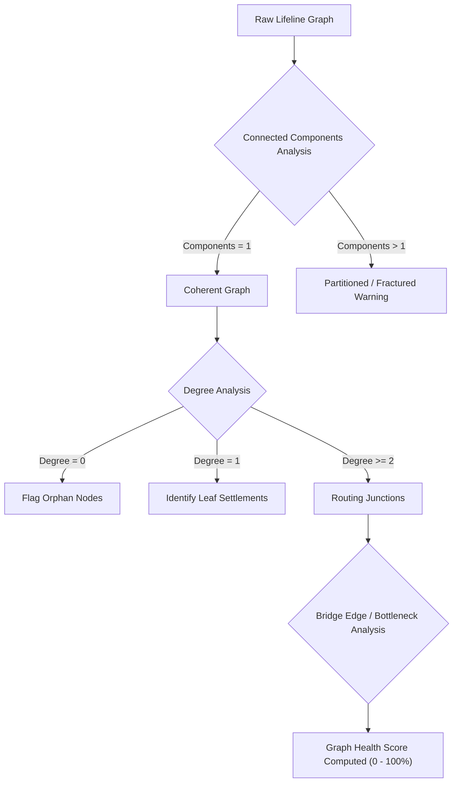

# GaunPulse — Infrastructure Graph Validation & Topology Rules

This document specifies the mathematical graph theory principles, topological validation checks, and travel-time modeling implemented in **GaunPulse** and its **Python NetworkX Intelligence Engine**.

---

## 1. Graph Model Definition

A village infrastructure network is modeled as an undirected attributed graph $G = (V, E)$:
- **Vertices ($V$)**: Spatial infrastructure nodes (settlement centroids, public clinics, schools, water intakes, transit junctions).
- **Edges ($E$)**: Lifeline connections (roads, suspension bridges, stone-stepped footpaths).
- **Edge Weights ($W$)**: Physical distance in meters ($d$) and estimated travel time in minutes ($t$).

---

## 2. Topological Integrity Diagnostics

Every village network is evaluated against a real-time integrity check:

### A. Connected Components
- Uses Breadth-First Search (BFS) / NetworkX `connected_components`.
- If the graph contains $> 1$ component, settlements in disconnected components cannot reach essential municipal services (e.g. Health Post or School), triggering an urgent warning.

### B. Orphan Nodes (Degree = 0)
- Nodes with degree 0 represent unlinked spatial points (e.g., a water tap or settlement with no connecting trail or road).
- Every orphan node deducts 10 points from the overall Village Health Score.

### C. Dangling Edges
- Edges whose `source_node_id` or `target_node_id` does not resolve to an active node in the database.
- Severe violation; deducts 20 points per dangling edge.

### D. Single Points of Failure (Bridges / Cut-Edges)
- An edge $e \in E$ is a bridge if $G - \{e\}$ increases the number of connected components.
- In rural Nepal, suspension footbridges crossing mountain river gorges frequently serve as cut-edges. The Infrastructure Impact Simulator isolates these bridges to compute household isolation metrics.

---

## 3. Travel Time Estimation Model

When an edge does not have explicit survey travel times, GaunPulse automatically calculates estimated travel minutes based on terrain and surface type:

$$\text{Travel Time (minutes)} = \frac{\text{Length (meters)}}{\text{Speed (m/min)}}$$

| Infrastructure & Surface Type | Mode | Speed (km/h) | Speed (m/min) |
|---|---|---|---|
| Blacktop / Paved Road | Vehicular | 30.0 km/h | 500 m/min |
| Gravel / Murram Road | 4WD / Tractor | 18.0 km/h | 300 m/min |
| Earthen / Dirt Track | 4WD (Dry) | 10.0 km/h | 166 m/min |
| Suspension Bridge | Pedestrian / Mule | 4.0 km/h | 66 m/min |
| Mountain Footpath / Stone Steps | Pedestrian | 3.5 km/h | 58 m/min |

---

## 4. Integration with Simulation & AI Agents

1. **Infrastructure Impact Simulator**:
   Uses the validated graph $G$ to simulate bridge failures or road washouts. Computes unreachable settlements and newly isolated populations using NetworkX `shortest_path_length` and `has_path`.
2. **AI Prioritization Agent**:
   Combines graph cut-edge centrality, affected household counts, and severity weights to rank municipal emergency repair priorities.
