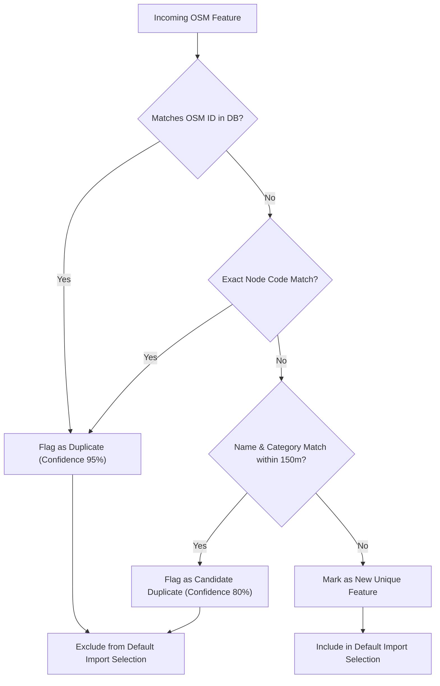

# Infrastructure Import Validation & Verification Guide

## Overview

Importing external geospatial data into a municipal decision-support system carries significant risk if incoming features collide with, corrupt, or overwrite ground-truth data collected by local ward leaders and engineers.

This document describes the validation rules, deduplication mechanisms, and verification safeguards enforced by GaunPulse.

---

## 1. Administrative Hierarchy Verification

Prior to any data discovery or import, the target village must reside within a valid administrative hierarchy:

1. **Province-District Integrity**:
   - The selected district must legitimately exist within the assigned province (e.g. Mustang must belong to Gandaki Province; Sindhupalchok must belong to Bagmati Province).
2. **District-Palika Integrity**:
   - The municipality / rural municipality must be a recognized local government unit within the designated district.
3. **Hierarchy Correction Flow**:
   - Planners can invoke `/api/villages/audit-hierarchy` to identify orphaned or misaligned villages.
   - Calling `/api/villages/{id}/correct-hierarchy` rebinds the village to its canonical province/district/palika and creates a permanent entry in `audit_logs`.

---

## 2. Deduplication & Spatial Proximity Rules

Incoming OSM features are checked against existing records in MySQL using a multi-tier deduplication heuristic:



### Protection of Ground-Truth Records

- **Verified Record Immutability**:
  Any node or edge marked with:
  ```sql
  verification_status IN ('verified', 'community_endorsed')
  ```
  is **strictly preserved**. OSM imports will never overwrite coordinates, names, or operational statuses of locally confirmed infrastructure without an explicit administrative override.

---

## 3. Data Integrity & Missing Data Principles

- **No Synthetic Records**:
  GaunPulse strictly forbids fabricating artificial schools, water points, or population numbers when OSM coverage is sparse.
- **Explicit Unmapped State**:
  If no schools, health posts, or bridges exist in the selected radius, the preview and dashboard render an informative disclaimer:
  > *"No mapped records found in the selected data source. Local verification is needed."*
  This prompts local municipal technicians to conduct GPS field surveys rather than falsely assuming the community lacks essential services.

---

## 4. Audit Logging & Reversibility

Every import generates a comprehensive audit record in the `audit_logs` table:

```json
{
  "village_id": 4,
  "action_type": "imported",
  "entity_type": "village",
  "performed_by": "OpenStreetMap Syncer",
  "summary": "Imported 14 nodes, 8 edges, and 3 facilities from OpenStreetMap.",
  "details": {
    "batch_id": "osm_import_65b38d9f1",
    "created_nodes": 14,
    "created_edges": 8,
    "created_facilities": 3,
    "skipped_verified": 2
  }
}
```

Planners can inspect previous import batches at `/api/villages/{id}/import-history` to trace when geographic features were added and by whom.
