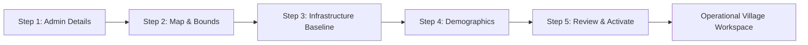

# GaunPulse — Village Onboarding Workflow Guide

This document outlines the architecture, data structures, and operational procedures for onboarding real rural wards and villages into **GaunPulse — The Village That Speaks**.

---

## 1. Overview & Purpose

GaunPulse transforms raw municipal administrative records and geographic features into an AI-ready spatial graph. The **Village Onboarding Wizard** provides an interactive, 5-step workflow that guides municipal planners and GIS officers through setting up village workspaces.

---

## 2. Five-Step Onboarding Architecture

### Step 1: Administrative Location & Village Details
- **Province**: Selected from the 7 official provinces of Nepal (Koshi, Madhesh, Bagmati, Gandaki, Lumbini, Karnali, Sudurpashchim).
- **District**: Filtered dynamically based on selected province.
- **Municipality / Rural Municipality**: Filtered based on district (showing English & Nepali Devanagari names, e.g., `हेलम्बु गाउँपालिका`).
- **Ward Number**: Official ward selection (e.g., Wards 1 to 7).
- **Village Name**: English identifier and local Nepali name.
- **Admin Code**: Standardized geographic code (e.g. `NP-P3-SIN-HEL-W4`).

### Step 2: Map Setup & Spatial Boundaries
- **Center Coordinates**: Geographic center point (WGS84 `latitude`, `longitude`). Automatically populated from municipality defaults.
- **Boundary GeoJSON**: Optional boundary polygon or multi-polygon defining the ward's territorial jurisdiction.
- **Default Coverage Envelope**: Standard ~2.5 km municipal operational radius.

### Step 3: Baseline Infrastructure Setup
- Seed or import baseline lifelines:
  - Road junctions and pedestrian trail crossings.
  - Suspension bridges over river gorges.
  - Essential civic assets: primary health posts, community basic/secondary schools, drinking water reservoirs (Muhan).
- Input methods:
  1. Manual entry via modal forms.
  2. One-click standard rural ward template loader.
  3. GeoJSON / CSV file upload.
  4. OpenStreetMap Overpass live ingestion.

### Step 4: Demographics & Population Baseline
- **Settlement Groups (Toles / Hamlets)**:
  - Residential cluster names.
  - Verified household counts (`households`).
  - Estimated population (`population`).
- **Data Source**: Cites the reference authority (e.g., *National Population and Housing Census 2021 / Helambu Rural Municipality Baseline Survey*).
- **Reference Year**: Baseline reference year (e.g., `2024` or `2026`).

### Step 5: Review, Graph Validation & Activation
- Full review of geographic, infrastructural, and demographic records.
- Live Graph Topological Integrity Check:
  - Validates connected components count.
  - Flags orphaned or isolated nodes.
  - Ensures all edges resolve to valid database nodes.
- **Draft Persistence**: Can be saved as an incomplete draft at any stage (`status = 'draft'`).
- **Activation (`status = 'active'`)**:
  - Unlocks the village across the entire GaunPulse platform.
  - Immediately enables the Village Map, Civic Issue logging, Infrastructure Impact Simulator, and the Unified AI Workspace.

---

## 3. Database Schema & State Transitions

Villages progress through the following lifecycle states:

| Status | Description | Allowed Actions |
|---|---|---|
| `draft` | Incomplete onboarding progress. | Editable via wizard, hidden from public citizens. |
| `active` | Fully validated and activated. | Available in Simulator, Map, Issue Logger, AI Workspace. |
| `archived` | Deprecated or superseded baseline. | Read-only historical audit reference. |

---

## 4. Multi-Municipality Scoping & Isolation

- Each village record belongs to a specific municipality (`municipality` / `municipality_id`).
- When a municipal administrator is authenticated, queries to `/api/villages` automatically scope to their authorized municipal jurisdiction.
- Cross-municipality modifications are strictly prevented at the API layer.
